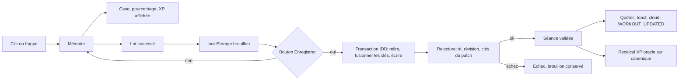

# DPLUS-04 — Architecture D+ détaillée

D+ reprend D (états montré / en vol / confirmé / échec, tranche canonique, garde endurance, moteur XP comme oracle) et ajoute trois pièces que D reportait : brouillon durable séparé, patch de clés dans une transaction, confirmation qui dit ce qu'elle prouve.

Pas de nouveau store IndexedDB. Pas de journal. Pas de framework d'état.

---

## 1. Sources de vérité

| Nom | Support | Rôle |
| --- | --- | --- |
| `memory` | refs React de l'onglet | Ce que la frame peint |
| `draft` | `localStorage`, clé `workoutSession_backup_${scope}_${date}` | Brouillon durable, **non** lu par `mergeSessionDaysIntoAggregate` |
| `canonical` | IndexedDB `workoutSessions`, id `scope:date` | Séance validée |
| `endurance` | ligne `workouts`, sous-arbre endurance, garde `mergeEnduranceWithoutSilentWipe` | GTG, pompes, autres types |
| `derived` | mémoire, recalculable | %, XP, grades, caches |
| `cloud` | push existant, après validation seulement | Niveau 4 **si** le compte et le flag sont là. Pas une preuve locale. |

`data` React, le temps de la migration, miroir de `canonical` + endurance pour les écrans non migrés. Aujourd'hui lit `memory`.

Révision de jour : entier sur la ligne canonique, incrémenté dans la transaction qui écrit. Révision de brouillon : entier dans l'objet `localStorage`, indépendant. Les deux ne se comparent pas entre eux. On compare une révision canonique à la révision lue au début de la transaction.

## 2. Flux

Le chemin du haut (peinture) ne joint pas le chemin du bas. Le bouton est la seule porte vers `canonical`.

## 3. Transitions

Mêmes noms que D, avec un état de plus entre mémoire et canonique.

| État | Signification UI honnête |
| --- | --- |
| `visible` | Peint, pas encore parti vers `localStorage` |
| `draft_pending` | Lot en file, page encore ouverte |
| `draft_stored` | `setItem` réussi. Survit à un rechargement. **Pas** une séance validée. |
| `inflight` | Transaction canonique ouverte, seulement après le bouton |
| `validated` | Relecture conforme de cette révision |
| `failed` | Brouillon gardé, canonique inchangé, pas de toast de succès |
| `conflict` | Clé divergente, canonique non écrasé sur cette clé |

Discard depuis `draft_stored` : enlever la clé, revenir à `canonical` en mémoire. Ne pas écrire une journée vide dans IndexedDB.

## 4. Séquences

### 4.1 Une coche, pas de bouton

1. Mémoire : clé tractions = true. Case et pourcentage se peignent.
2. XP affichée : moteur sur la mémoire, après peinture (ou terme prouvé égal, DPLUS-05). Ce nombre n'est pas « l'XP enregistrée ».
3. Avant 400 ms, ou tout de suite si on flush les coches sans attendre les frappes de reps : `setItem` de la tranche du jour.
4. Quêtes : non. Cloud : non. Ligne `scope:date` : inchangée.
5. Crash ensuite : au prochain chargement, le chargeur de brouillon restaure la mémoire. Le merge canonique ne voit pas cette clé `localStorage`.

### 4.2 Enregistrer

1. Swap de repos éventuel, comme aujourd'hui, **avant** la transaction, parce que c'est un effet du bouton.
2. Patch = clés différentes entre canonique connu et mémoire.
3. Transaction : `get` id `scope:date`, fusion des clés disjointes, conflit si divergence, `put`, révision + 1.
4. Relecture `get` : id présent, révision égale, chaque clé du patch égale la valeur écrite.
5. Seulement alors : effacer le brouillon `localStorage` de ce jour, toast, idle quêtes, `WORKOUT_UPDATED`, push cloud.
6. Si l'étape 4 échoue : garder le brouillon, toast d'échec, canonique pas déclaré validé.

### 4.3 Onglet A tractions, onglet B dips

Voir DPLUS-03. Les deux patches sont disjoints. Deux transactions successives. Les deux clés restent. Aucun `WORKOUT_UPDATED` de validation tant que chaque onglet n'a pas enfoncé Enregistrer pour **son** patch. Le brouillon `localStorage` est par origine **et** par onglet seulement au sens où `localStorage` est partagé : la clé est la même pour les deux onglets.

Conséquence à ne pas rater : deux onglets qui écrivent la même clé `localStorage` de brouillon se marchent dessus **avant** même la transaction. Parade : le brouillon stocke un patch + la révision canonique lue, pas une tranche complète seule. Au `setItem`, relire la clé (synchrone), fusionner les patches disjoints, réécrire. Même règle de conflit. `localStorage` n'a pas de transaction multi-onglets ; deux `setItem` peuvent encore se croiser. La **promotion** canonique, elle, est transactionnelle et rattrape le cas. Le brouillon est un filet, pas l'arbitre final. Le dire dans l'UI : le brouillon durable est best-effort entre onglets ; la validation ne l'est pas.

### 4.4 GTG

1. Mémoire endurance mise à jour, barre GTG peinte.
2. Pas de parcours des maps `reps` / `checkedExercises`.
3. Transaction sur la ligne agrégat : relire `enduranceData`, `mergeEnduranceWithoutSilentWipe` avec le sous-arbre GTG entrant, écrire ce sous-arbre, ne pas remplacer `checkedExercises` par la mémoire de l'onglet.
4. Les jours de séance restent ceux de `workoutSessions` au chargement. Test G obligatoire avant de juger ça suffisant.
5. Timeout : échec explicite. Plus de `return` silencieux.

Le garde anti-liste-vide reste appelé. Une liste incoming non vide remplace encore la liste de ce type : c'est le contrat actuel du garde, pas une fusion reps-à-reps. Deux onglets qui ajoutent chacun une séance pompes peuvent se perdre une séance si chacun envoie sa liste complète. **Limite D+ assumée** tant qu'on n'a pas un patch « append id de séance » pour l'endurance. Ne pas le déguiser en résolu. Première livraison GTG : un onglet, plus le test qu'une coche de séance canonique survit. La fusion de deux listes de séances concurrentes est un incrément suivant, pas un slogan.

### 4.5 Fermeture

`pagehide` : `setItem` du brouillon s'il est plus récent que le dernier `draft_stored`. Pas de toast. Pas de promotion canonique (on n'est pas dans le bouton ; les quêtes ne doivent pas partir parce que l'utilisateur a fermé la page). Si `setItem` jette, la perte est réelle.

Kill sans événement : seul un `setItem` déjà revenu protège. D'où la coalescence courte pendant la vie de la page.

## 5. Calculs dérivés

Sources seulement en entrée. Aucun calcul n'écrit une coche, une rep ou une séance.

| Calcul | Entrée | Quand | S'il est en retard |
| --- | --- | --- | --- |
| Pourcentage de séance | `memory` | Même tour que le patch | L'ancien pourcentage n'est pas réaffiché par-dessus une mémoire plus récente : on ignore un résultat dont la révision mémoire est plus vieille |
| XP affichée | `memory` + Garmin + nutrition déjà chargés | Après peinture | Idem : un résultat de révision n ne remplace pas n+1. Tant que le complet n'est pas là, on garde le dernier résultat **de cette même révision ou de la précédente**, jamais un mélange. Libellé interne : non validé. |
| Grades | total du complet XP de cette révision | Après le complet | Pas de grade calculé sur un delta partiel |
| XP « officielle » quêtes / cloud | `canonical` | Après validation | Ne bouge pas à la coche |

Worker : **non** dans la première livraison. Le cloner tout l'historique peut coûter autant que le calcul. Décision après la phase 0, seulement si les long tasks du calcul dépassent le gain du clone. Le Worker ne devient pas une source de vérité.

Classes 1 et 2 du document 4 (termes additifs vs seuils) restent valables, publiées seulement après test d'égalité stricte avec `calculateSportXP`. Plafonds, bonus 80/100, dédoublonnage, fractionné : classe 2 ou 3, jamais un `+constante` aveugle.

## 6. Vérification proportionnée

À la promotion canonique, sur les clés du patch seulement :

1. la ligne existe (déjà là) ;
2. `revision` égale celle qu'on vient d'écrire ;
3. chaque clé du patch a la valeur envoyée.

Pas de hash de tout l'historique à chaque coche. Un hash de la tranche **du patch** (JSON canonique trié des clés touchées) est optionnel et redondant avec (3) si (3) est fait. Le retenir seulement si (3) s'avère trop cher en mesures. Un hash ne prouve pas le fsync, ni la confidentialité, ni qu'une autre ligne n'a pas été effacée.

Faux positif : comparaison de nombres `10` et `"10"` si le sanitize change le type. Le payload comparé est celui **après** sanitize, des deux côtés. Faux négatif : ne pas relire une clé qu'on croit non touchée alors que le `put` a remplacé toute la ligne. D'où l'obligation de relire aussi le nombre de clés du jour, pas seulement le patch : s'il a baissé sans suppression dans le patch, échec. Ça détecte un remplacement trop large. Ça ne détecte pas une corruption d'une clé non lue. Accepté : proportionné au patch, pas un audit complet de l'historique.

## 7. Confidentialité

- Pas de télémétrie réseau pour les mesures.
- Le brouillon `localStorage` contient les mêmes données personnelles que la séance (reps, poids). Même origine, même profil. Ce n'est pas une fuite vers un tiers. C'est une copie de plus sur la machine. L'effacement (discard, validation, déconnexion) doit supprimer cette clé. À vérifier dans la phase brouillon : aujourd'hui ce n'est pas le cas, parce que la clé n'est pas écrite.
- Les logs d'échec : code d'erreur, pas la tranche.
- Le cloud ne part pas au moment du brouillon. Moins de copies réseau qu'un autosave qui pousserait chaque coche.
- Déconnexion : la cible doit effacer les clés `workoutSession_backup_${scope}_*` de ce scope. **Exigence D+, pas un comportement vérifié de l'existant** pour ces clés, puisqu'elles ne sont pas branchées.

## 8. Ce qui reste hors D+

Event sourcing, store nouveau, serveur d'arbitrage, CRDT, hash global systématique, Worker par défaut, version par exercice, fusion fine de deux listes de séances endurance concurrentes (limite nommée en 4.4).
